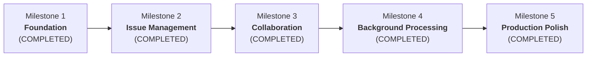

# DevTrack — Project Phases & Progress Tracking

> **Platform:** Full-Stack Issue Tracking & Team Collaboration Platform  
> **Backend:** Java 21, Spring Boot 3.4.2, Spring Security, Spring Data JPA, PostgreSQL, Flyway  
> **Frontend:** React 18, TypeScript, Vite, TanStack Query  
> **Current Status:** All 5 Milestones Complete (100%) | Production Ready

---

## 1. Project Phase & Milestone Roadmap

The implementation is structured into 5 sequential milestones across 4 architectural phases to ensure clean boundaries, test-driven validation, and verified deliverables:

---

## 2. Milestone Execution Status

### Milestone 1: Foundation
- **Status:** **COMPLETED**
- **Goal:** Repository scaffolding, database containerization, PostgreSQL Flyway migrations, stateless Spring Security with HttpOnly JWT + Bearer fallback, user registration & login, standardized exception handling, and frontend authentication flow.
- **Deliverables:**
  - [x] Scaffolding: `backend/` (Spring Boot 3.4.2, Java 21) & `frontend/` (React 18, TS, Vite).
  - [x] Infrastructure: `docker-compose.yml` for PostgreSQL, `.env.example`, root `.gitignore`, and `README.md`.
  - [x] Database: Flyway migration `V1__create_users_and_projects.sql` with `users`, `projects`, and `project_members` tables, foreign keys, unique constraints, and indexes.
  - [x] Security: BCrypt password hashing, HMAC-SHA256 JWT service (`JwtService`), `JwtAuthenticationFilter` with HttpOnly cookie + Bearer token support, JSON 401/403 handlers without stack trace leakage.
  - [x] Domain & DTOs: `User`, `Project`, `ProjectMember`, `ProjectRole`, `RegisterRequest`, `LoginRequest`, `AuthResponse`, `UserResponse`.
  - [x] REST Endpoints:
    - `POST /api/auth/register` (201 Created + HttpOnly Cookie)
    - `POST /api/auth/login` (200 OK + HttpOnly Cookie)
    - `POST /api/auth/logout` (200 OK + clears cookie)
    - `GET /api/users/me` (200 OK + current user profile)
  - [x] Error Handling: RFC-compliant JSON errors via `@RestControllerAdvice` (`GlobalExceptionHandler`).
  - [x] Frontend: `AuthContext` with login/register/logout hooks, `LoginPage`, `RegisterPage`, `ProtectedRoute`, `Navbar`, and `DashboardPage`.
  - [x] Automated Tests: 15 passing backend tests (8 integration, 7 unit/context), zero failures, verified frontend production build.

---

### Milestone 2: Issue Management
- **Status:** **COMPLETED**
- **Goal:** Project creation & membership authorization, Issue CRUD with `@Version` optimistic locking, server-side filtering, sorting, pagination, and project/issue screens.
- **Deliverables:**
  - [x] Project Service & REST Endpoints:
    - `POST /api/projects` (Create project, auto-assign creator as `OWNER`)
    - `GET /api/projects` (List projects accessible to current user)
    - `GET /api/projects/{projectId}` (Project details & permissions)
    - `PATCH /api/projects/{projectId}` (Update project settings, OWNER only)
    - `GET /api/projects/{projectId}/members` (List members)
    - `POST /api/projects/{projectId}/members` (Add member)
    - `DELETE /api/projects/{projectId}/members/{userId}` (Remove member)
  - [x] Issue Domain & Flyway Migration `V2`:
    - `issues` table: id, project_id, issue_number, title, description, type, status, priority, reporter_id, assignee_id, due_date, version, timestamps.
    - `project_counters` table for atomic, locked sequence allocation.
    - Unique constraint on `(project_id, issue_number)`.
    - Optimistic locking with JPA `@Version` returning `409 Conflict` on concurrent collisions.
  - [x] Issue REST Endpoints:
    - `POST /api/projects/{projectId}/issues` (Create issue with atomic issue number generation)
    - `GET /api/projects/{projectId}/issues` (Server-side pagination, sorting, and filters: status, priority, assignee, type, overdue, search)
    - `GET /api/issues/{issueId}` (Issue detail)
    - `PATCH /api/issues/{issueId}` (Update issue with version validation)
    - `DELETE /api/issues/{issueId}` (Delete issue)
  - [x] Frontend Screens:
    - `ProjectsPage` with responsive cards, role badges, and member counts.
    - `CreateProjectModal` with auto-key suggestion and validation.
    - `ProjectDetailsPage` with filter bar (search, status, priority, type, overdue).
    - `CreateIssueModal` and `EditIssueModal` with optimistic lock conflict detection.
    - `ManageMembersModal` for adding and removing team members.
  - [x] Automated Tests:
    - `ProjectIntegrationTest`: 4 tests verifying CRUD, duplicate keys, access denial to non-members, and member management.
    - `IssueIntegrationTest`: 6 tests verifying sequential numbering (CORE-1, CORE-2), optimistic locking 409 conflict, server-side filtering, and assignee validation.

---

### Milestone 3: Team Collaboration
- **Status:** **COMPLETED**
- **Goal:** Issue comments, immutable activity history, Kanban drag-and-drop board, and dashboard aggregate metrics.
- **Deliverables:**
  - [x] Flyway Migration `V3__create_comments_and_activity.sql`:
    - `comments` table with foreign keys, cascade deletes, and composite indexes.
    - `activity_events` immutable table capturing actor, issue, event type, and details.
  - [x] Activity Audit Domain:
    - `ActivityEvent` entity with `ActivityEventType` (`ISSUE_CREATED`, `STATUS_CHANGED`, `PRIORITY_CHANGED`, `ASSIGNEE_CHANGED`, `COMMENT_ADDED`, `COMMENT_DELETED`).
    - `@Transactional(propagation = Propagation.MANDATORY)` audit logging directly wired into issue creation, editing, and comment lifecycle.
    - `ActivityController`: `GET /api/issues/{issueId}/activity`.
  - [x] Comment Domain:
    - `Comment` entity, `CommentRepository` with eager author fetch query.
    - `CommentService` enforcing author-only edit policy, author or project owner deletion policy, and project membership checks.
    - `CommentController`: `POST /api/issues/{id}/comments`, `GET /api/issues/{id}/comments`, `PATCH /api/comments/{id}`, `DELETE /api/comments/{id}`.
  - [x] Analytics & Dashboard Domain:
    - JPQL server-side aggregate queries in `IssueRepository` (`GROUP BY status`, `GROUP BY priority`, `GROUP BY assignee`).
    - `DashboardService` scoping metrics to projects accessible by the authenticated user.
    - `DashboardController`: `GET /api/dashboard/summary`, `GET /api/dashboard/workload`, `GET /api/dashboard/recent-activity`.
  - [x] Frontend Collaboration UI:
    - `CommentsSection`: Chronological discussion, author edit in-place, delete controls, and relative timestamps.
    - `ActivityTimeline`: Detailed event cards with visual action icons, timestamps, and actor info.
    - Enhanced `EditIssueModal`: Tabbed navigation between Details, Comments, and Activity History.
    - `KanbanBoard`: 4 status columns (`TODO`, `IN_PROGRESS`, `IN_REVIEW`, `DONE`), HTML5 drag-and-drop status changes, quick status advance controls, and conflict rollback handling.
    - `ProjectDetailsPage`: Dynamic view switcher between Table View and Kanban Board.
    - `DashboardPage`: Live metrics with project filter, KPI cards (Total, Assigned, Overdue, Completion Rate), status/priority charts, team workload table, and recent activity stream.
  - [x] Automated Tests:
    - `CommentIntegrationTest`: 6 tests verifying comment creation, audit logging, outsider 403 rejection, author-only editing, and author/owner deletion.
    - `DashboardIntegrationTest`: 6 tests verifying cross-project summary aggregates, single-project filtering, outsider project denial (403), assignee workload breakdown, and user-scoped recent activity.

---

### Milestone 4: Background Processing & Concurrency
- **Status:** **COMPLETED**
- **Goal:** In-app notifications, bounded thread pool executor, backpressure, transactional outbox for reliable event delivery, and concurrency stress tests.
- **Deliverables:**
  - [x] Flyway Migration `V4__create_notifications_and_outbox.sql`:
    - `notifications` table: recipient_id, type, message, issue_id, created_at, read_at.
    - `outbox_events` table: aggregate_type, aggregate_id, event_type, payload, status, retry_count, timestamps.
  - [x] In-App Notification Domain:
    - `Notification` entity, `NotificationType` enum, `NotificationRepository` with unread count query and bulk read update.
    - `NotificationService` enforcing strict recipient privacy (users cannot view or mark another user's notifications as read).
    - `NotificationController`: `GET /api/notifications`, `GET /api/notifications/unread-count`, `PATCH /api/notifications/{id}/read`, `PATCH /api/notifications/read-all`.
  - [x] Bounded ThreadPoolTaskExecutor with Backpressure (`AsyncConfig`):
    - `ThreadPoolTaskExecutor` with `corePoolSize = 4`, `maxPoolSize = 8`, bounded `queueCapacity = 50`.
    - Custom named thread factory `devtrack-worker-%d`.
    - Deliberate `RejectedExecutionHandler` recording backpressure metrics (`ExecutorMetrics`) and rejecting with `RejectedExecutionException`.
    - Graceful shutdown with 30s termination await timeout.
  - [x] Transactional Outbox Pattern:
    - `OutboxEventService`: `@Transactional(propagation = Propagation.MANDATORY)` guarantees outbox event insertion in the exact same DB transaction as issue creation, assignment, status change, and comment.
    - `OutboxPollingWorker`: Scheduled worker using PostgreSQL `SELECT ... FOR UPDATE SKIP LOCKED` claiming query, dispatching events to worker pool without race conditions.
    - `OutboxEventProcessor`: `@Transactional(propagation = Propagation.REQUIRES_NEW)` processes event, delivers notification, and tracks bounded retries (max 3) before marking `FAILED`.
  - [x] Frontend Notification Center:
    - `NotificationDropdown`: Bell icon in `Navbar` with unread badge counter, polling for new alerts, single-click mark as read, and "Mark all read" button.
  - [x] Performance Benchmark Script:
    - `benchmark/concurrency_benchmark.py`: Pure standard-library Python benchmark measuring throughput (req/sec), p50/p95/p99 latency percentiles, and error rates.
  - [x] Automated Tests:
    - `NotificationIntegrationTest`: 6 tests verifying listing, unread count, read marking, outsider 403 prevention, mark all read, and end-to-end outbox delivery.
    - `ConcurrencyIntegrationTest`: 4 multi-threaded tests verifying 20-thread simultaneous issue creation without duplicate keys, 10-thread optimistic locking conflict detection, bounded queue backpressure and rejection metric tracking, and idempotent outbox deduplication.

---

### Milestone 5: Production Polish & Portfolio Readiness
- **Status:** **COMPLETED**
- **Goal:** Docker Compose multi-container deployment, CI/CD pipeline, OpenAPI documentation, performance benchmark, and complete portfolio documentation.
- **Deliverables:**
  - [x] Multi-Stage Backend Dockerfile (`backend/Dockerfile`):
    - Build stage with Eclipse Temurin 21 JDK Alpine and Maven wrapper.
    - Hardened Alpine runtime stage with Eclipse Temurin 21 JRE, unprivileged non-root user (`devtrack:devtrack`), and Spring Boot Actuator liveness healthcheck.
  - [x] Multi-Stage Frontend Dockerfile (`frontend/Dockerfile` & `nginx.conf`):
    - Build stage with Node 20 Alpine executing TypeScript verification and Vite compilation.
    - Nginx 1.27 Alpine runtime stage serving static bundles with Gzip compression, security headers, SPA client-side routing fallback, and reverse-proxying `/api/` and `/actuator/` requests.
  - [x] Production Docker Compose (`docker-compose.prod.yml`):
    - Orchestrates PostgreSQL 16 Alpine, Spring Boot backend, and Nginx frontend on a shared bridge network.
    - Explicit health check dependency order (`condition: service_healthy`) and persistent data volumes.
  - [x] Continuous Integration Pipeline (`.github/workflows/ci.yml`):
    - Triggers on push and pull requests to `master` and `main`.
    - Live PostgreSQL 16 service container running Maven integration and concurrency tests.
    - Frontend TypeScript verification and production build.
    - Multi-stage Docker build verification.
  - [x] Observability & Actuator Health Monitoring:
    - Added `spring-boot-starter-actuator` to `pom.xml`, exposing `/actuator/health` and `/actuator/info` with test verification in `DevTrackApplicationTests`.
  - [x] Empirical Performance & Concurrency Benchmark (`benchmark/BENCHMARK_RESULTS.md`):
    - Tested across 1, 5, 10, and 20 concurrent threads against live PostgreSQL database.
    - Measured throughput up to 209.74 req/sec, p50 latency down to 30.00 ms, and 0.00% error rate.
    - Documented HikariCP connection pool saturation and concurrency trade-offs.
  - [x] Comprehensive Portfolio Documentation:
    - Rewrote `README.md` with complete architecture diagram, entity relationship model (ERD), API endpoints guide, Docker instructions, benchmark charts, and environment configuration.
    - Added ADR-012 in `DECISIONS.md`.

---

## 3. Verified Test & Verification Matrix

| Scope | Test Suite | Executed | Passed | Failed | Status |
|---|---|:---:|:---:|:---:|:---:|
| **Backend** | `AuthIntegrationTest` | 8 | 8 | 0 | PASSED |
| **Backend** | `IssueIntegrationTest` | 6 | 6 | 0 | PASSED |
| **Backend** | `ProjectIntegrationTest` | 4 | 4 | 0 | PASSED |
| **Backend** | `CommentIntegrationTest` | 6 | 6 | 0 | PASSED |
| **Backend** | `DashboardIntegrationTest` | 6 | 6 | 0 | PASSED |
| **Backend** | `NotificationIntegrationTest` | 6 | 6 | 0 | PASSED |
| **Backend** | `ConcurrencyIntegrationTest` | 4 | 4 | 0 | PASSED |
| **Backend** | `AuthServiceTest` | 4 | 4 | 0 | PASSED |
| **Backend** | `JwtServiceTest` | 2 | 2 | 0 | PASSED |
| **Backend** | `DevTrackApplicationTests` | 2 | 2 | 0 | PASSED |
| **Frontend** | Type Check (`tsc`) & Vite Build | 1 | 1 | 0 | PASSED |
| **Total** | | **49** | **49** | **0** | **100% Verified** |

---

## 4. Key Architectural Decisions (ADR Summary)

1. **Architecture Style — Modular Monolith:** Single Spring Boot service and PostgreSQL database. Eliminates premature microservice distributed transaction overhead while maintaining clean package separation.
2. **Authentication Strategy — HttpOnly Cookie + Bearer Fallback:** Web browsers store JWT in an `HttpOnly`, `SameSite=Lax` cookie to guard against XSS token exfiltration. Programmatic API clients and tests can supply `Authorization: Bearer <token>`.
3. **Optimistic Locking Guard:** Database records for issues use JPA `@Version` to detect concurrent write collisions and return HTTP `409 Conflict` instead of silent overwrites.
4. **Issue Numbering Strategy:** Composite uniqueness on `(project_id, issue_number)` enforced in PostgreSQL schema to guarantee conflict-free key generation.
5. **Atomic Sequence Counter Pattern:** Native PostgreSQL upsert with `RETURNING last_issue_number` guarantees gapless, race-condition-free issue numbers under high thread concurrency.
6. **Append-Only Activity Audit Trail:** Immutable `activity_events` with `Propagation.MANDATORY` guaranteeing audit persistence in the same transaction as state mutations.
7. **Server-Side Database Aggregation:** Live metrics calculated in PostgreSQL via JPQL `GROUP BY` and `SUM` rather than fetching entities into memory.
8. **Bounded Worker Pool & Backpressure:** Dedicated `ThreadPoolTaskExecutor` capped at 8 active threads and 50 queued tasks prevents OOM and gracefully rejects overflow tasks.
9. **Transactional Outbox Pattern:** Outbox events committed inside primary business transactions and polled via `FOR UPDATE SKIP LOCKED` decouple notification delivery and eliminate race conditions.
10. **Multi-Stage Containerization & CI/CD Pipeline:** Hardened unprivileged container images (Temurin JRE non-root + Nginx Alpine) automated by GitHub Actions.

