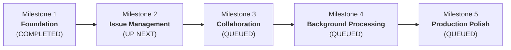

# DevTrack — Project Phases & Progress Tracking

> **Platform:** Full-Stack Issue Tracking & Team Collaboration Platform  
> **Backend:** Java 21, Spring Boot 3.4.2, Spring Security, Spring Data JPA, PostgreSQL, Flyway  
> **Frontend:** React 18, TypeScript, Vite, TanStack Query  
> **Current Status:** Milestone 1 Complete | Ready for Milestone 2

---

## 1. Project Phase & Milestone Roadmap

The implementation is structured into 5 sequential milestones across 4 architectural phases to ensure clean boundaries, test-driven validation, and verified deliverables:

---

## 2. Milestone Execution Status

### Milestone 1: Foundation
- **Status:** **COMPLETED**
- **Goal:** Repository scaffolding, database containerization, PostgreSQL Flyway migrations, stateless Spring Security with HttpOnly JWT + Bearer fallback, user registration & login, standardized exception handling, and frontend authentication flow.
- **Deliverables:**
  - [x] Scaffolding: `backend/` (Spring Boot 3.4.2, Java 21) & `frontend/` (React 18, TS, Vite).
  - [x] Infrastructure: `docker-compose.yml` for PostgreSQL, `.env.example`, root `.gitignore`, and `README.md`.
  - [x] Database: Flyway migration `V1__create_users_and_projects.sql` with `users`, `projects`, and `project_members` tables, foreign keys, unique constraints, and indexes.
  - [x] Security: BCrypt password hashing, HMAC-SHA256 JWT service (`JwtService`), `JwtAuthenticationFilter` with HttpOnly cookie + Bearer token support, JSON 401/403 handlers without stack trace leakage.
  - [x] Domain & DTOs: `User`, `Project`, `ProjectMember`, `ProjectRole`, `RegisterRequest`, `LoginRequest`, `AuthResponse`, `UserResponse`.
  - [x] REST Endpoints:
    - `POST /api/auth/register` (201 Created + HttpOnly Cookie)
    - `POST /api/auth/login` (200 OK + HttpOnly Cookie)
    - `POST /api/auth/logout` (200 OK + clears cookie)
    - `GET /api/users/me` (200 OK + current user profile)
  - [x] Error Handling: RFC-compliant JSON errors via `@RestControllerAdvice` (`GlobalExceptionHandler`).
  - [x] Frontend: `AuthContext` with login/register/logout hooks, `LoginPage`, `RegisterPage`, `ProtectedRoute`, `Navbar`, and `DashboardPage`.
  - [x] Automated Tests: 15 passing backend tests (8 integration, 7 unit/context), zero failures, verified frontend production build.

---

### Milestone 2: Issue Management
- **Status:** **PLANNED / UP NEXT**
- **Goal:** Project creation & membership authorization, Issue CRUD with `@Version` optimistic locking, server-side filtering, sorting, pagination, and project/issue screens.
- **Key Features to Implement:**
  - [ ] Project Service & REST Endpoints:
    - `POST /api/projects` (Create project, auto-assign creator as `OWNER`)
    - `GET /api/projects` (List projects accessible to current user)
    - `GET /api/projects/{projectId}` (Project details & permissions)
    - `PATCH /api/projects/{projectId}` (Update project settings, OWNER only)
    - `GET /api/projects/{projectId}/members` (List members)
    - `POST /api/projects/{projectId}/members` (Add member)
    - `DELETE /api/projects/{projectId}/members/{userId}` (Remove member)
  - [ ] Issue Domain & Flyway Migration `V2`:
    - `issues` table: id, project_id, issue_number, title, description, type (`TASK`, `BUG`, `FEATURE`), status (`TODO`, `IN_PROGRESS`, `IN_REVIEW`, `DONE`), priority (`LOW`, `MEDIUM`, `HIGH`, `URGENT`), reporter_id, assignee_id, due_date, version, timestamps.
    - Unique constraint on `(project_id, issue_number)`.
    - Optimistic locking with JPA `@Version` returning `409 Conflict` on concurrent collisions.
  - [ ] Issue REST Endpoints:
    - `POST /api/projects/{projectId}/issues` (Create issue with atomic issue number generation)
    - `GET /api/projects/{projectId}/issues` (Server-side pagination, sorting, and filters: status, priority, assignee, type, overdue)
    - `GET /api/issues/{issueId}` (Issue detail)
    - `PATCH /api/issues/{issueId}` (Update issue with version validation)
    - `DELETE /api/issues/{issueId}` (Delete issue)
  - [ ] Frontend Screens:
    - Project list & project creation dialog.
    - Project workspace view with member list.
    - Issue list with filtering, sorting, and pagination controls.
    - Issue create/edit modal and detail view.
  - [ ] Automated Tests:
    - Unit tests for issue status transitions, authorization rules, and project membership.
    - Integration tests for project CRUD, issue CRUD, filtering, pagination, and optimistic locking conflict detection.

---

### Milestone 3: Team Collaboration
- **Status:** **QUEUED**
- **Goal:** Issue comments, immutable activity history, Kanban drag-and-drop board, and dashboard aggregate metrics.
- **Key Features to Implement:**
  - [ ] Comments: `comments` table, author-only edit/delete policy, validated input.
  - [ ] Activity History: `activity_events` append-only audit trail capturing issue creation, status changes, assignments, and priority changes.
  - [ ] Kanban Board: Interactive board with status columns (`TODO`, `IN_PROGRESS`, `IN_REVIEW`, `DONE`), drag-and-drop state persistence, rollback on server error.
  - [ ] Dashboard Metrics: Backend aggregate queries for total issues, status distribution, overdue count, and assignee workload.
  - [ ] Automated Tests: Comment authorization tests, audit trail immutability tests, dashboard aggregation tests.

---

### Milestone 4: Background Processing & Concurrency
- **Status:** **QUEUED**
- **Goal:** In-app notifications, bounded thread pool executor, backpressure, transactional outbox for reliable event delivery, and concurrency stress tests.
- **Key Features to Implement:**
  - [ ] Notification System: `notifications` table, list notifications, mark single/all as read, recipient privacy checks.
  - [ ] Bounded Worker Pool: Explicit `ThreadPoolExecutor` with bounded queue, custom named thread factory, deliberate rejection policy, and graceful shutdown.
  - [ ] Transactional Outbox: Event persistence within the same DB transaction as issue mutations, polling background worker with deduplication and bounded retries.
  - [ ] Concurrency Verification: Multi-threaded tests verifying no duplicate issue keys under concurrent creation, conflict detection under concurrent updates, and queue backpressure behavior.

---

### Milestone 5: Production Polish & Portfolio Readiness
- **Status:** **QUEUED**
- **Goal:** Docker Compose multi-container deployment, CI/CD pipeline, OpenAPI documentation, performance benchmark, and complete portfolio documentation.
- **Key Features to Implement:**
  - [ ] Containerization: Multi-stage Dockerfile for backend and frontend, production `docker-compose.prod.yml`.
  - [ ] CI Pipeline: GitHub Actions workflow building and testing backend and frontend on push/PR.
  - [ ] Documentation: Complete API docs, architecture diagrams, measured benchmark latency numbers (p50/p95/p99), and environment variable guide.

---

## 3. Verified Test & Verification Matrix

| Scope | Test Suite | Executed | Passed | Failed | Status |
|---|---|---|---|---|---|
| **Backend** | `AuthIntegrationTest` | 8 | 8 | 0 | PASSED |
| **Backend** | `AuthServiceTest` | 4 | 4 | 0 | PASSED |
| **Backend** | `JwtServiceTest` | 2 | 2 | 0 | PASSED |
| **Backend** | `DevTrackApplicationTests` | 1 | 1 | 0 | PASSED |
| **Frontend** | Type Check (`tsc`) & Vite Build | 1 | 1 | 0 | PASSED |
| **Total** | | **16** | **16** | **0** | **100% Verified** |

---

## 4. Key Architectural Decisions (ADR Summary)

1. **Architecture Style — Modular Monolith:** Single Spring Boot service and PostgreSQL database. Eliminates premature microservice distributed transaction overhead while maintaining clean package separation.
2. **Authentication Strategy — HttpOnly Cookie + Bearer Fallback:** Web browsers store JWT in an `HttpOnly`, `SameSite=Lax` cookie to guard against XSS token exfiltration. Programmatic API clients and tests can supply `Authorization: Bearer <token>`.
3. **Optimistic Locking Guard:** Database records for issues will use JPA `@Version` to detect concurrent write collisions and return HTTP `409 Conflict` instead of silent overwrites.
4. **Issue Numbering Strategy:** Composite uniqueness on `(project_id, issue_number)` enforced in PostgreSQL schema to guarantee conflict-free key generation.
