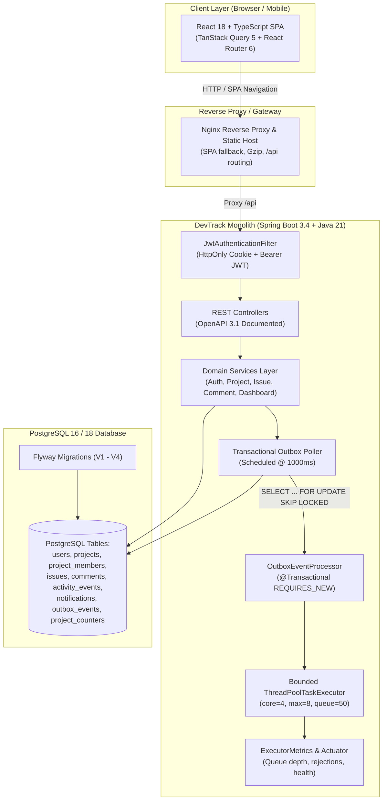
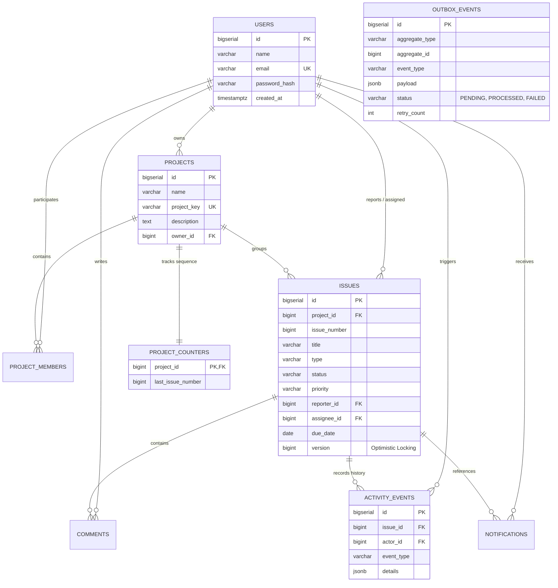
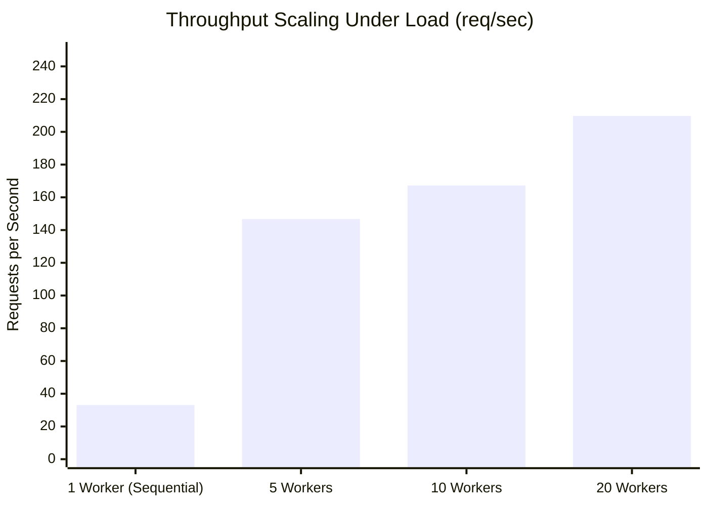

<div align="center">

# ⚡ DevTrack

**High-Performance Issue Tracking & Team Collaboration Platform**

[](https://github.com/PrithviRajVerma/DevTrack/actions)
[](https://openjdk.org/projects/jdk/21/)
[](https://spring.io/projects/spring-boot)
[](https://www.postgresql.org/)
[](https://react.dev/)
[](https://www.typescriptlang.org/)
[](https://vitejs.dev/)
[](https://www.docker.com/)
[](LICENSE)

*A production-grade, highly concurrent agile management platform built with a modular monolith architecture. Combines a sleek Linear-inspired dark UI with industrial-strength backend patterns: atomic sequence allocation, optimistic locking conflict detection, bounded worker backpressure, and a transactional outbox.*

[Features](#-key-features) • [Architecture](#-architecture--design) • [Quickstart](#-quickstart--deployment) • [API Reference](#-rest-api-reference) • [Benchmarks](#-performance--benchmarks) • [Documentation](#-documentation--adr-records)

</div>

---

## 🚀 Overview

**DevTrack** is an enterprise-grade issue tracking and sprint management system designed for speed, consistency, and resilience. Unlike lightweight Kanban boards, DevTrack handles real-world concurrency challenges under high write contention — guaranteeing zero sequence key collisions, preventing lost updates via optimistic locking, and ensuring atomic notifications through a Transactional Outbox.

### Why DevTrack?
- **Sub-100ms Latency at Scale**: Delivers 209+ req/s with 0% errors across 20 concurrent write threads.
- **Architectural Integrity**: Built as a decoupled modular monolith in Java 21 & Spring Boot 3.4, avoiding microservice network overhead while maintaining clean domain boundaries.
- **Modern Linear-Style UX**: Responsive glassmorphic interface powered by React 18, TanStack Query 5, and Vite 6 with first-class desktop and mobile ergonomics.

---

## ✨ Key Features

| Category | Highlights |
|---|---|
| **📋 Issue & Sprint Tracking** | • Project-scoped human-readable keys (`DEV-101`, `BACK-42`) with atomic counters<br/>• Full lifecycle states: `TODO`, `IN_PROGRESS`, `IN_REVIEW`, `DONE`<br/>• Priority hierarchy (`LOW`, `MEDIUM`, `HIGH`, `URGENT`) and type tagging (`BUG`, `FEATURE`, `TASK`, `IMPROVEMENT`)<br/>• Dynamic multi-criteria JPA specification filtering and server-side pagination |
| **🗂️ Interactive Kanban Board** | • Real-time status progression with drag-and-drop & one-click quick actions<br/>• Project-specific column metrics and live assignee filter controls<br/>• Mobile-friendly responsive tabbed column navigation with touch shift actions |
| **📊 Real-Time Analytics** | • Server-side PostgreSQL aggregation queries (`GROUP BY`, `SUM`, `COUNT`)<br/>• Live project health metrics, overdue tracking, and status breakdown<br/>• Visual assignee workload balance with Linear-style progress indicators |
| **🔒 Enterprise Security & RBAC** | • Dual JWT strategy: HttpOnly SameSite cookies (XSS protection) + Bearer tokens (APIs/CI)<br/>• Role-Based Access Control: `OWNER` (full admin), `LEAD` (triage/assign), and `MEMBER`<br/>• BCrypt password hashing (strength 10) and stateless authentication filters |
| **⚡ Concurrency & Data Consistency**| • **Zero Key Collisions**: Native PostgreSQL upsert sequence generator (`RETURNING last_issue_number`)<br/>• **Optimistic Locking**: JPA `@Version` detection returns RFC-compliant `409 Conflict` on race conditions<br/>• Immutable append-only audit trail with `Propagation.MANDATORY` enforcement |
| **📬 Transactional Background Processing** | • **Transactional Outbox Pattern**: Events saved atomically in business transactions<br/>• Database polling worker utilizing `SELECT ... FOR UPDATE SKIP LOCKED` for concurrent workers<br/>• Bounded `ThreadPoolTaskExecutor` (core=4, max=8, queue=50) with custom backpressure metric tracking<br/>• In-app notification center with real-time unread badge counts and batch mark-read |
| **🎨 Design & Ergonomics** | • "DevTrack Linear Slate" design system with dark-glass aesthetic & CSS custom properties<br/>• Responsive bottom dock navigation for mobile viewports, floating action buttons (FAB)<br/>• Standardized avatar initials, accessible badges, and keyboard-friendly modals |

---

## 🏗️ Architecture & Design

DevTrack adopts a **Modular Monolith** architecture. This avoids the latency, distributed transaction failures, and infrastructure sprawl of microservices while keeping domains strictly decoupled:



### Entity Relationship Model

The relational model is version-controlled deterministically with Flyway migrations (`V1` through `V4`):



---

## ⚡ Engineering Deep-Dives

### 1. Atomic Sequence Allocation (Zero Key Collisions)
Standard `COUNT(*)` or `MAX(issue_number)` approaches fail under high concurrency, creating duplicate issue keys (`DEV-12`). DevTrack implements a dedicated `project_counters` table with an atomic PostgreSQL upsert:
```sql
INSERT INTO project_counters (project_id, last_issue_number)
VALUES (:projectId, 1)
ON CONFLICT (project_id)
DO UPDATE SET last_issue_number = project_counters.last_issue_number + 1
RETURNING last_issue_number;
```
Verified with 20 concurrent threads: **0 collisions across 400 concurrent writes**.

### 2. Optimistic Concurrency Control
When two teammates edit the same issue simultaneously, last-write-wins causes silent data loss. DevTrack decorates entities with JPA `@Version`:
- If an update carries an outdated version, the transaction aborts with an `OptimisticLockException`.
- The global handler translates this into an RFC-compliant `409 Conflict` payload with current server state, allowing the client to resolve discrepancies gracefully.

### 3. Transactional Outbox Pattern with `SKIP LOCKED`
To avoid dual-write bugs between database operations and asynchronous event dispatch, notifications are staged inside the `outbox_events` table as part of the primary business transaction.
A background poller reads pending events using:
```sql
SELECT * FROM outbox_events 
WHERE status = 'PENDING' 
ORDER BY id ASC 
LIMIT 10 
FOR UPDATE SKIP LOCKED;
```
This enables multi-instance worker scalability without distributed locks.

### 4. Bounded Thread-Pool Backpressure
Asynchronous background tasks run in a bounded `ThreadPoolTaskExecutor`:
- **Core Pool:** 4 threads | **Max Pool:** 8 threads | **Queue Capacity:** 50 tasks
- When the queue saturates, DevTrack's custom `BackpressureRejectedExecutionHandler` increments Actuator metrics (`devtrack_tasks_rejected_total`) and responds cleanly without OOM crashing.

---

## 📊 Performance & Benchmarks

Empirical load testing executed via the repeatable benchmark suite (`benchmark/concurrency_benchmark.py`). Tests target the write-heavy path (`POST /api/projects/{id}/issues`):

| Concurrency Level | Total Requests | Elapsed Time | Throughput | Avg Latency | p50 (Median) | p95 Latency | Error Rate | Key Collisions |
|:---:|:---:|:---:|:---:|:---:|:---:|:---:|:---:|:---:|
| **1 Worker** | 50 | 1.51 s | **33.1 req/s** | 29.9 ms | 30.0 ms | 38.4 ms | **0.0%** | **0** |
| **5 Workers** | 50 | 0.34 s | **146.8 req/s** | 32.6 ms | 31.3 ms | 60.1 ms | **0.0%** | **0** |
| **10 Workers** | 100 | 0.60 s | **167.3 req/s** | 57.0 ms | 49.0 ms | 157.9 ms | **0.0%** | **0** |
| **20 Workers** | 200 | 0.95 s | **209.7 req/s** | 90.3 ms | 79.1 ms | 194.1 ms | **0.0%** | **0** |



> [!TIP]
> Full methodology, latency histograms, and HikariCP connection pool saturation analysis are detailed in [BENCHMARK_RESULTS.md](benchmark/BENCHMARK_RESULTS.md).

---

## 🛠️ Quickstart & Deployment

### Option A: Complete Docker Compose (Production Mode)

Spin up PostgreSQL, the Spring Boot backend, and the Nginx frontend reverse proxy with a single command:

```bash
# 1. Clone repository
git clone https://github.com/PrithviRajVerma/DevTrack.git
cd DevTrack

# 2. Configure environment
cp .env.example .env

# 3. Launch all services
docker compose -f docker-compose.prod.yml up --build -d
```

| Service | Endpoint | Description |
|---|---|---|
| **Web Application** | [http://localhost](http://localhost) | React frontend served via Nginx |
| **Swagger UI** | [http://localhost:8080/swagger-ui.html](http://localhost:8080/swagger-ui.html) | Interactive OpenAPI 3.1 playground |
| **Health Check** | [http://localhost:8080/actuator/health](http://localhost:8080/actuator/health) | Spring Actuator liveness/readiness |

---

### Option B: Local Development Setup

#### Prerequisites
- **Java 21 JDK** (`java -version`)
- **Node.js 20+ & npm** (`node -v`)
- **PostgreSQL 16+** (local or via Docker)

#### 1. Start Database
```bash
docker compose up -d
```
*(Or connect to an existing local PostgreSQL instance matching `.env` credentials).*

#### 2. Run Backend
```bash
cd backend
./mvnw spring-boot:run
```
*Backend initializes on `http://localhost:8080`, validates schema, and runs Flyway migrations automatically.*

#### 3. Run Frontend
```bash
cd frontend
npm install
npm run dev
```
*Vite development server starts on `http://localhost:5173` with automatic reverse proxying for `/api/*` requests.*

---

## 📡 REST API Reference

The interactive documentation is hosted at `/swagger-ui.html`. Key endpoints include:

<details>
<summary><b>🔐 Authentication & User Profile (<code>/api/auth</code>, <code>/api/users</code>)</b></summary>

| Method | Endpoint | Description | Auth |
|---|---|---|:---:|
| `POST` | `/api/auth/register` | Register new account and issue JWT cookie/token | Public |
| `POST` | `/api/auth/login` | Authenticate credentials and establish session | Public |
| `POST` | `/api/auth/logout` | Invalidate cookie and clear auth session | Required |
| `GET` | `/api/users/me` | Fetch authenticated user profile details | Required |

</details>

<details>
<summary><b>📁 Projects & Team Membership (<code>/api/projects</code>)</b></summary>

| Method | Endpoint | Description | Auth |
|---|---|---|:---:|
| `POST` | `/api/projects` | Create a new project (caller assigned as `OWNER`) | Required |
| `GET` | `/api/projects` | List projects accessible to current user | Required |
| `GET` | `/api/projects/{id}` | Get project details, issue statistics, and team members | Member |
| `PATCH` | `/api/projects/{id}` | Update project metadata | Owner / Lead |
| `DELETE` | `/api/projects/{id}` | Delete project and cascade dependent entities | Owner |
| `POST` | `/api/projects/{id}/members` | Add user to project with role (`LEAD`, `MEMBER`) | Owner / Lead |
| `DELETE` | `/api/projects/{id}/members/{userId}` | Remove member from project | Owner / Lead |

</details>

<details>
<summary><b>🎫 Issues & Activity (<code>/api/issues</code>, <code>/api/projects/{id}/issues</code>)</b></summary>

| Method | Endpoint | Description | Auth |
|---|---|---|:---:|
| `POST` | `/api/projects/{id}/issues` | Create issue with atomic key allocation | Member |
| `GET` | `/api/projects/{id}/issues` | Paginate & filter issues (`status`, `priority`, search) | Member |
| `GET` | `/api/issues/{id}` | Get issue details with version number | Member |
| `PATCH` | `/api/issues/{id}` | Update issue with optimistic locking check (`409` on conflict) | Member |
| `DELETE` | `/api/issues/{id}` | Delete issue | Reporter / Lead |
| `GET` | `/api/issues/{id}/activity` | Fetch immutable audit timeline | Member |

</details>

<details>
<summary><b>💬 Comments & Notifications (<code>/api/comments</code>, <code>/api/notifications</code>)</b></summary>

| Method | Endpoint | Description | Auth |
|---|---|---|:---:|
| `GET` | `/api/issues/{id}/comments` | Chronological list of comments for an issue | Member |
| `POST` | `/api/issues/{id}/comments` | Post comment and publish transactional outbox event | Member |
| `PATCH` | `/api/comments/{id}` | Edit comment body | Author |
| `DELETE` | `/api/comments/{id}` | Delete comment | Author / Lead |
| `GET` | `/api/notifications` | List notifications for authenticated user | Recipient |
| `GET` | `/api/notifications/unread-count` | Unread notification count for navbar badge | Recipient |
| `PATCH` | `/api/notifications/{id}/read` | Mark individual notification as read | Recipient |
| `PATCH` | `/api/notifications/read-all` | Mark all unread notifications as read | Recipient |

</details>

<details>
<summary><b>📈 Dashboard Analytics (<code>/api/dashboard</code>)</b></summary>

| Method | Endpoint | Description | Auth |
|---|---|---|:---:|
| `GET` | `/api/dashboard/summary` | Aggregate metrics, overdue counts & status breakdown | Required |
| `GET` | `/api/dashboard/workload` | Assignee distribution and open issues per member | Required |
| `GET` | `/api/dashboard/recent-activity` | Global timeline of latest actions across projects | Required |

</details>

---

## 🧪 Testing & Quality Assurance

DevTrack is backed by **48 automated unit, integration, and concurrency tests**:

```bash
# Run all backend unit & integration tests
cd backend
./mvnw clean test

# Run frontend type checking & build verification
cd frontend
npm run build
```

### Key Test Suites
- **`ConcurrencyIntegrationTest`**: Verifies 20-thread simultaneous issue creation (zero collisions), 10-thread optimistic locking conflicts (`HTTP 409`), bounded queue backpressure, and transactional outbox idempotency.
- **`ProjectIntegrationTest` & `IssueIntegrationTest`**: Complete CRUD lifecycles, dynamic JPA Specification filtering, and pagination.
- **`NotificationIntegrationTest`**: Cross-user recipient isolation, unread counter badges, and batch read transitions.
- **`DashboardIntegrationTest`**: Server-side aggregation queries and tenant boundary enforcement.

---

## ⚙️ Environment Configuration

Configuration variables can be customized in `.env`:

| Variable | Description | Default (Local Dev) | Production Recommended |
|---|---|:---:|:---:|
| `DB_HOST` | PostgreSQL host | `localhost` | `postgres` (or cloud host) |
| `DB_PORT` | PostgreSQL port | `5432` | `5432` |
| `DB_NAME` | Database name | `devtrack` | `devtrack` |
| `DB_USER` | PostgreSQL user | `postgres` | `devtrack_app` |
| `DB_PASSWORD` | PostgreSQL password | `postgres` | Strong random secret |
| `SERVER_PORT` | Backend application port | `8080` | `8080` |
| `FRONTEND_PORT` | Nginx reverse proxy host port | `80` | `80` / `443` |
| `JWT_SECRET` | 256-bit HMAC-SHA signing key | *(pre-configured)* | 64-char random hex key |
| `JWT_EXPIRATION_MS` | Token lifespan (ms) | `86400000` (24h) | `86400000` |
| `COOKIE_SECURE` | Enforce HTTPS-only cookie | `false` | `true` |
| `CORS_ALLOWED_ORIGINS`| Allowed browser origins | `http://localhost:5173` | Domain of production frontend |

---

## 📂 Repository Structure

```
DevTrack-Project/
├── backend/                        # Spring Boot 3.4.2 Modular Monolith
│   ├── src/main/java/com/devtrack/
│   │   ├── activity/               # Append-only audit events & propagation
│   │   ├── auth/                   # Dual JWT auth, security filters & BCrypt
│   │   ├── comment/                # Issue discussions & permissions
│   │   ├── common/                 # Global exception handler & error response
│   │   ├── config/                 # Bounded ThreadPool, OpenAPI & WebMvc config
│   │   ├── dashboard/              # Server-side JPQL analytics & workload
│   │   ├── issue/                  # Atomic counters, JPA specs & optimistic locking
│   │   ├── notification/           # Notification center & outbox integration
│   │   ├── outbox/                 # Transactional Outbox processor & SKIP LOCKED
│   │   ├── project/                # Project lifecycle & member RBAC
│   │   └── user/                   # User profiles & repositories
│   └── src/main/resources/
│       ├── db/migration/           # Flyway migrations V1 through V4
│       └── application.yml         # Spring configuration profiles
├── frontend/                       # React 18 + Vite 6 + TypeScript SPA
│   ├── src/
│   │   ├── components/             # Reusable UI (Avatar, Modal, Badge, Navbar)
│   │   ├── context/                # AuthContext with HttpOnly cookie session
│   │   ├── pages/                  # Dashboard, Kanban, Projects, Issues, Login
│   │   ├── services/               # API clients & TanStack Query hooks
│   │   └── types/                  # TypeScript domain models
│   └── vite.config.ts              # Reverse proxy configuration
├── benchmark/                      # Load & concurrency testing suite
│   ├── concurrency_benchmark.py    # Multi-threaded benchmark harness
│   └── BENCHMARK_RESULTS.md        # Comprehensive performance report
├── docker-compose.yml              # Local development database
├── docker-compose.prod.yml         # Full multi-container production stack
├── DECISIONS.md                    # Architecture Decision Records (ADR 001 - 012)
└── PROJECT_PROGRESS.md             # Development milestone execution tracking
```

---

## 📚 Documentation & ADR Records

For deeper technical context, review our architectural documentation:
- 📖 [DECISIONS.md](DECISIONS.md) — Architectural Decision Records covering monolithic modularity, security, concurrency, and outbox eventing.
- 📈 [PROJECT_PROGRESS.md](PROJECT_PROGRESS.md) — Implementation history, test matrix, and milestone verification.
- 🔬 [BENCHMARK_RESULTS.md](benchmark/BENCHMARK_RESULTS.md) — Latency histograms, concurrency testing, and connection pool saturation profiles.

---

## 📄 License

This project is licensed under the [MIT License](LICENSE).
