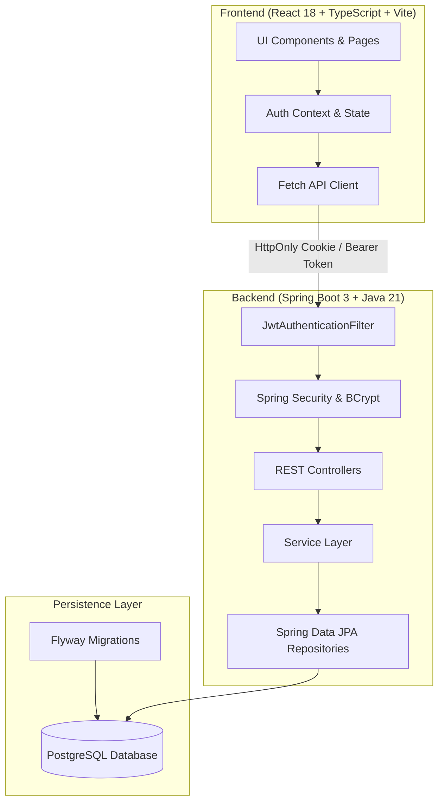
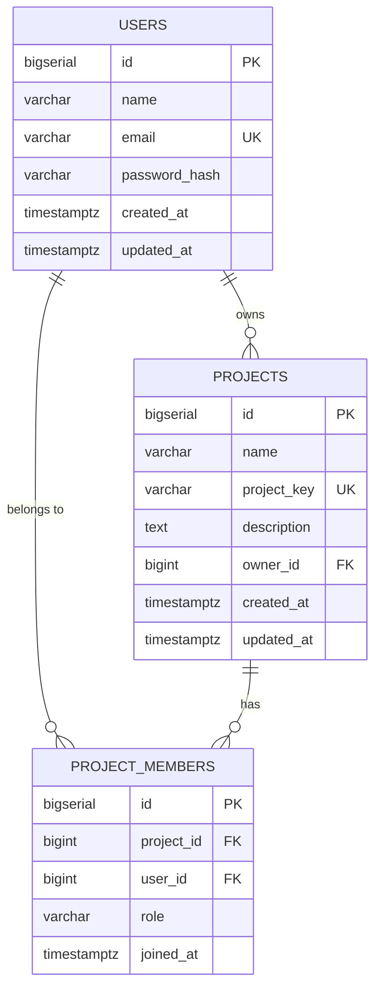

# DevTrack — Full-Stack Issue Tracking & Team Collaboration Platform

DevTrack is a modern, production-minded issue tracking and team collaboration platform built with a Java 21 / Spring Boot 3 backend and a React / TypeScript / Vite frontend.

## Project Status: Milestone 1 Completed (Foundation)

| Milestone | Scope | Status |
|---|---|---|
| **Milestone 1: Foundation** | Project scaffold, PostgreSQL & Flyway migrations, Spring Security with HttpOnly JWT, user registration/login/logout, protected routes, automated test suite | **Completed** |
| **Milestone 2: Issue Management** | Project CRUD & membership, Issue CRUD, filtering, pagination, optimistic locking concurrency | Next up |
| **Milestone 3: Collaboration** | Issue comments, activity history, Kanban drag-and-drop board, dashboard analytics | Queued |
| **Milestone 4: Background Processing** | Bounded thread pool executor, transactional outbox, in-app notifications, retry policy | Queued |
| **Milestone 5: Production Polish** | Dockerized builds, CI/CD, OpenAPI/Swagger UI, performance benchmarks, deployment | Queued |

---

## Architecture Overview

DevTrack is designed as a **modular monolith** with clean separation of concerns and layered architecture:



### Database Entity Model (Milestone 1)



---

## Technology Stack

- **Backend:** Java 21, Spring Boot 3.4.2, Spring Security, Spring Data JPA (Hibernate), PostgreSQL Driver, Flyway Migration, Jakarta Bean Validation, JJWT (0.12.6), springdoc-openapi (2.8.5).
- **Frontend:** React 18, TypeScript 5.7, Vite 6, React Router 6, TanStack React Query 5, Lucide React.
- **Testing:** JUnit 5, Mockito, AssertJ, Spring Boot Test / MockMvc, Testcontainers.
- **DevOps:** Docker, Docker Compose.

---

## Authentication & Security Design

1. **Password Hashing:** Passwords are never stored in plain text and are hashed using adaptive `BCryptPasswordEncoder`.
2. **Session / Token Handling:** Authentication issues signed HMAC-SHA256 JWTs stored in secure `HttpOnly`, `SameSite=Lax` cookies named `devtrack_token`. For API/programmatic clients, `Authorization: Bearer <token>` is also supported.
3. **Stateless Security:** Spring Security session policy is configured as `SessionCreationPolicy.STATELESS`.
4. **Normalized Credentials:** Emails are trimmed and lowercased before lookup and storage; database unique constraints guarantee uniqueness.
5. **Standardized Error Handling:** Global `@RestControllerAdvice` formats errors into RFC-compliant responses without leaking internal stack traces:
   ```json
   {
     "timestamp": "2026-10-14T06:14:48.035Z",
     "status": 409,
     "error": "Conflict",
     "message": "Email is already registered: john@example.com",
     "path": "/api/auth/register"
   }
   ```

---

## Local Development Setup

### Prerequisites
- Java 21 JDK
- Node.js (v18+) and npm
- Docker and Docker Compose (or local PostgreSQL)

### 1. Environment Configuration
Copy `.env.example` to `.env`:
```bash
cp .env.example .env
```

### 2. Start PostgreSQL
Using Docker Compose:
```bash
docker compose up -d
```
Or use a local PostgreSQL server with a database named `devtrack` and `devtrack_test`.

### 3. Run Backend
```bash
cd backend
mvn spring-boot:run
```
Backend runs on `http://localhost:8080`.
OpenAPI Swagger UI is available at `http://localhost:8080/swagger-ui.html`.

### 4. Run Frontend
```bash
cd frontend
npm install
npm run dev
```
Frontend runs on `http://localhost:5173`.

---

## Running Automated Tests

### Backend Tests
```bash
cd backend
mvn test
```
Executes all unit and integration tests (Flyway migrations automatically run against the test database):
- `AuthIntegrationTest`: Verifies user registration, duplicate email handling, input validation, login, cookie setting, protected endpoints, and logout.
- `AuthServiceTest`: Verifies business logic, password hashing, and exception mapping.
- `JwtServiceTest`: Verifies token signing, claims extraction, expiration, and signature validation.

### Frontend Type Check & Build
```bash
cd frontend
npm run build
```
Type-checks TypeScript files and creates optimized production bundle in `dist/`.
