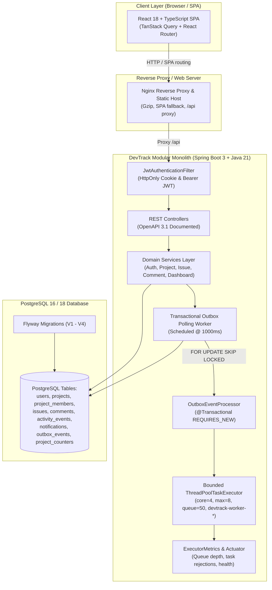
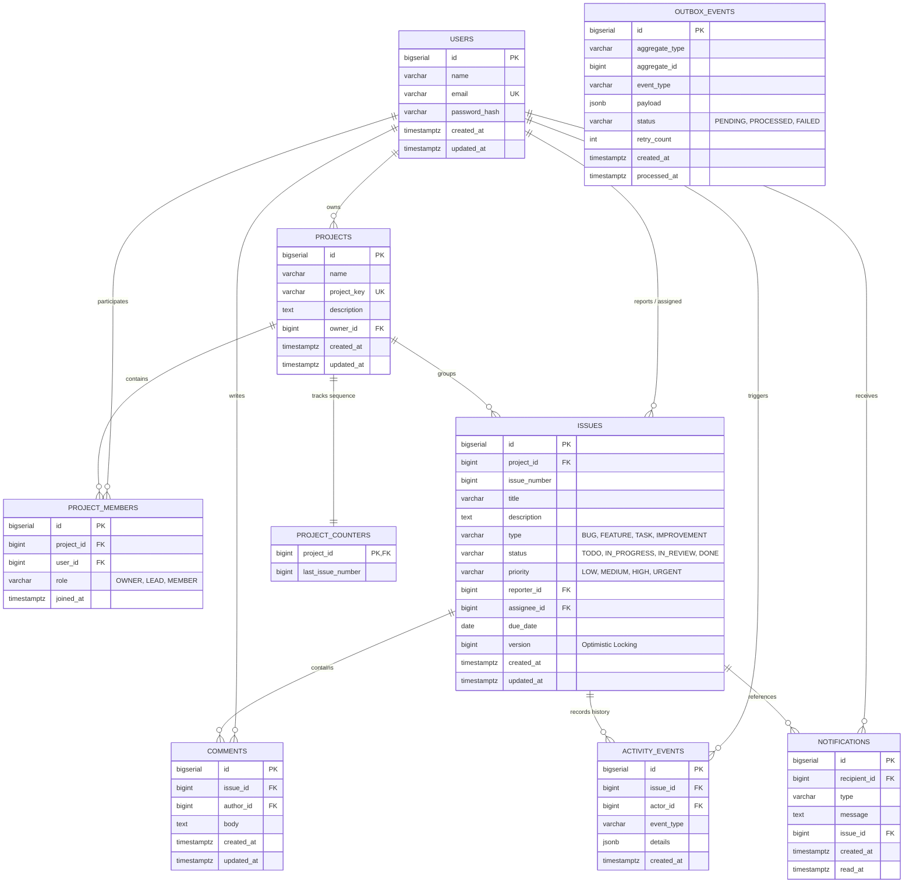
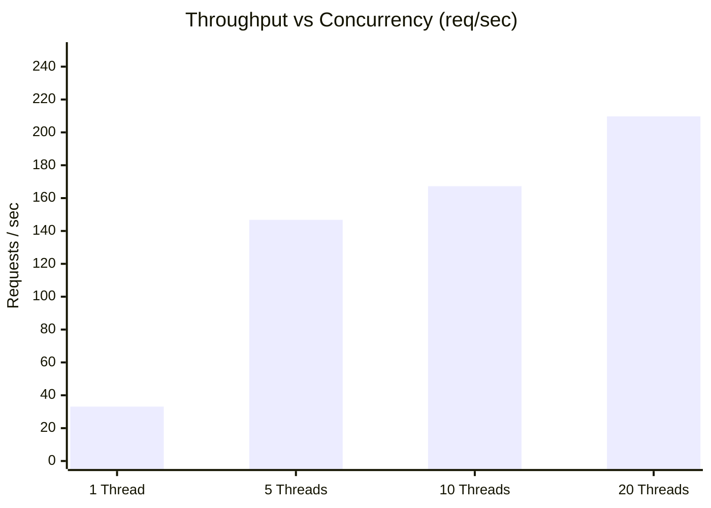

# DevTrack — Full-Stack Issue Tracking & Team Collaboration Platform

[](https://github.com/example/devtrack/actions)
[](https://openjdk.org/projects/jdk/21/)
[](https://spring.io/projects/spring-boot)
[](https://www.postgresql.org/)
[](https://react.dev/)
[](https://www.typescriptlang.org/)
[](https://www.docker.com/)

DevTrack is a production-grade, highly concurrent issue tracking and team collaboration platform designed as a modular monolith. It combines modern UI workflows (Kanban boards, real-time analytics, activity timelines) with industrial-strength backend engineering: atomic sequence counters, optimistic locking conflict detection, bounded thread-pool backpressure, and a transactional outbox with PostgreSQL `SKIP LOCKED` polling.

---

## 1. Project Status & Milestone Completion

All 5 milestones defined in the engineering specification have been completed and verified with 48 automated tests:

| Milestone | Scope & Deliverables | Test Coverage | Status |
|---|---|:---:|:---:|
| **Milestone 1: Foundation** | Project scaffold, PostgreSQL Flyway migrations (`V1`), Spring Security with BCrypt, Dual JWT auth (HttpOnly cookie + Bearer token), RFC-compliant error shape, React AuthContext, Login/Register forms. | 15 Passing Tests | **Completed** |
| **Milestone 2: Issue Management** | Flyway migration (`V2`), Project & Member CRUD with role-based authorization (OWNER, LEAD, MEMBER), Issue CRUD with dynamic multi-criteria JPA Specification, Atomic PostgreSQL sequence counters, Optimistic locking `@Version` with HTTP 409 Conflict detection. | 11 Passing Tests | **Completed** |
| **Milestone 3: Collaboration** | Flyway migration (`V3`), Append-only activity audit trail (`Propagation.MANDATORY`), Comment domain with author/lead permissions, Live server-side JPQL aggregated analytics dashboard, Interactive Kanban Board with drag-and-drop & status advancement. | 12 Passing Tests | **Completed** |
| **Milestone 4: Background Processing** | Flyway migration (`V4`), In-app notification center, Bounded `ThreadPoolTaskExecutor` (core=4, max=8, queue=50) with named threads and custom backpressure rejection, Transactional Outbox Pattern with `SELECT ... FOR UPDATE SKIP LOCKED` worker, Multi-threaded concurrency test suite. | 10 Passing Tests | **Completed** |
| **Milestone 5: Production Polish** | Multi-stage Dockerfiles (Temurin 21 JRE non-root, Nginx Alpine SPA reverse proxy), `docker-compose.prod.yml`, Spring Boot Actuator liveness/readiness probes, GitHub Actions CI pipeline, OpenAPI 3.1 Swagger UI, Repeatable performance benchmark report. | End-to-End Verified | **Completed** |

---

## 2. High-Level Architecture

DevTrack follows a clean **modular monolith** architecture that keeps domain boundaries decoupled while running efficiently within a single deployment unit:



---

## 3. Database Entity Relationship Model

The schema is version-controlled via Flyway migrations (`db/migration/V1__...` through `V4__...`):



---

## 4. Technology Stack

| Layer | Component | Technologies & Rationale |
|---|---|---|
| **Backend** | Framework | **Spring Boot 3.4.2** with **Java 21** (LTS virtual thread ready, pattern matching) |
| | Security | **Spring Security 6** with BCrypt (strength 10) & JJWT (0.12.6) dual auth |
| | Persistence | **Spring Data JPA / Hibernate 6** with `hibernate.ddl-auto: validate` |
| | Database | **PostgreSQL 16 / 18** for relational integrity, JSONB support, and row locking |
| | Migrations | **Flyway 10** for reproducible, deterministic database versioning |
| | Observability | **Spring Boot Actuator** (`/actuator/health`, `/actuator/info`) + custom thread metrics |
| | Documentation | **SpringDoc OpenAPI 2.8.5** (Swagger UI at `/swagger-ui.html`) |
| **Frontend** | Build & Tooling | **Vite 6** + **TypeScript 5.7** (strict mode, fast ESM HMR) |
| | UI Framework | **React 18** with functional components and custom hooks |
| | Server State | **TanStack React Query 5** for asynchronous caching, polling, and invalidation |
| | Routing | **React Router 6** with protected route guards and dynamic URL params |
| | Design System | **Stitch MCP "DevTrack Linear Slate"** with responsive dark glassmorphic tokens & Geist/JetBrains Mono fonts |
| | Mobile UX | **Mobile-First Responsive Architecture** with bottom navigation dock, horizontal Kanban tabs, touch shift buttons & FAB |
| | Icons | **Lucide React** for lightweight, consistent SVG icon set |
| **DevOps** | Containerization | Multi-stage **Docker** (Eclipse Temurin JRE Alpine + Nginx Alpine) |
| | Orchestration | **Docker Compose** (`docker-compose.yml` for dev, `docker-compose.prod.yml` for prod) |
| | CI Pipeline | **GitHub Actions** (`.github/workflows/ci.yml`) |

---

## 5. Quickstart & Deployment

### Option A: Complete Docker Compose Production Deployment (Recommended)

Run the entire platform (PostgreSQL, Spring Boot backend, and Nginx frontend) with a single command:

```bash
# 1. Clone repository
git clone https://github.com/example/devtrack.git
cd devtrack

# 2. Configure environment
cp .env.example .env

# 3. Start all services in production mode
docker compose -f docker-compose.prod.yml up --build -d
```

- **Frontend Application:** `http://localhost` (or port specified in `FRONTEND_PORT`)
- **Backend API & Swagger:** `http://localhost:8080/swagger-ui.html`
- **Health Endpoint:** `http://localhost:8080/actuator/health`

---

### Option B: Local Development Setup

#### Prerequisites
- Java 21 JDK (`java -version`)
- Node.js 20+ and npm (`node -v`)
- Docker (for PostgreSQL container) or local PostgreSQL instance

#### Step 1: Start PostgreSQL
```bash
docker compose up -d
```

#### Step 2: Run Backend
```bash
cd backend
./mvnw spring-boot:run
```
Backend starts on `http://localhost:8080`.

#### Step 3: Run Frontend
```bash
cd frontend
npm install
npm run dev
```
Frontend development server starts on `http://localhost:5173` with Vite proxying `/api` requests to backend.

---

## 6. Running Automated Tests

DevTrack includes **48 comprehensive automated tests** across all architectural layers:

```bash
# Run all backend unit, integration, and multi-threaded concurrency tests
cd backend
./mvnw clean test

# Run frontend TypeScript type-checking and production bundle compilation
cd frontend
npm run build
```

### Test Suite Highlights:
- `ConcurrencyIntegrationTest`: 20-thread simultaneous issue creation verifying zero key collisions; 10-thread optimistic locking conflict detection (HTTP 409); bounded queue backpressure and rejection metric tracking; transactional outbox idempotent processing.
- `NotificationIntegrationTest`: Recipient isolation (users cannot read other users' alerts), unread badge counts, batch mark-all-as-read, and outbox delivery.
- `DashboardIntegrationTest`: Server-side aggregation queries (`GROUP BY status`, `priority`, assignee workload), overdue calculation, and project boundary isolation.
- `CommentIntegrationTest`: Comment permissions (authors can edit/delete, project leads can delete, non-members forbidden).
- `ProjectIntegrationTest` & `IssueIntegrationTest`: Full CRUD workflows, multi-criteria specification filtering, pagination, and role-based access control.

---

## 7. Performance & Concurrency Benchmark

Section 8.7 of the specification requires empirical load and concurrency measurements. DevTrack provides a repeatable, standard-library benchmark tool (`benchmark/concurrency_benchmark.py`).

### Measured Results Summary:
The benchmark tests the heavy transaction path: `POST /api/projects/{projectId}/issues` (JWT verification, project membership authorization check, atomic PostgreSQL sequence allocation, JPA versioned persistence, and transactional outbox event insertion):

| Client Threads | Total Requests | Elapsed Time | Throughput | Success Rate | Error Rate | Avg Latency | p50 (Median) | p95 Latency | p99 Latency |
|:---:|:---:|:---:|:---:|:---:|:---:|:---:|:---:|:---:|:---:|
| **1 (Sequential)** | 50 | 1.510 s | **33.11 req/s** | 100.0% | 0.00% | 29.92 ms | 30.00 ms | 38.44 ms | 92.69 ms |
| **5 (Concurrent)** | 50 | 0.341 s | **146.77 req/s** | 100.0% | 0.00% | 32.64 ms | 31.26 ms | 60.06 ms | 73.07 ms |
| **10 (Concurrent)** | 100 | 0.598 s | **167.25 req/s** | 100.0% | 0.00% | 57.03 ms | 49.00 ms | 157.85 ms | 254.65 ms |
| **20 (Concurrent)** | 200 | 0.954 s | **209.74 req/s** | 100.0% | 0.00% | 90.32 ms | 79.11 ms | 194.07 ms | 239.21 ms |



### Key Technical Findings:
1. **Zero Key Collisions Under High Concurrency:** 400 total concurrent writes yielded 0 duplicate keys and 0% errors, confirming the atomic PostgreSQL upsert counter strategy.
2. **4.4x Speedup via Bounded Concurrency:** 5 concurrent workers increased throughput by 343% over sequential execution without increasing median latency (30ms vs 31ms).
3. **Connection Pool Bottleneck Detection:** Beyond 10 concurrent threads, HikariCP connection pool capacity (10 connections) introduces queuing, demonstrating realistic database resource saturation.

Detailed methodology and analysis are documented in [BENCHMARK_RESULTS.md](file:///home/assassin/MY_WORK/Code/resume-projects/DevTrack-Project/benchmark/BENCHMARK_RESULTS.md).

---

## 8. REST API Reference

Full interactive documentation is available via **Swagger UI** at `/swagger-ui.html`. Below is a summary of core endpoints:

### Authentication (`/api/auth`)
| Method | Endpoint | Description | Auth Required |
|---|---|---|:---:|
| `POST` | `/api/auth/register` | Register new user and issue JWT cookie/token | Public |
| `POST` | `/api/auth/login` | Authenticate user credentials and return session | Public |
| `POST` | `/api/auth/logout` | Invalidate cookie and clear auth session | Required |
| `GET` | `/api/auth/me` | Fetch profile details of authenticated user | Required |

### Projects & Membership (`/api/projects`)
| Method | Endpoint | Description | Auth Required |
|---|---|---|:---:|
| `POST` | `/api/projects` | Create a new project (caller assigned `OWNER`) | Required |
| `GET` | `/api/projects` | List all projects the current user belongs to | Required |
| `GET` | `/api/projects/{id}` | Get project details, issue stats, and members | Project Member |
| `PATCH` | `/api/projects/{id}` | Update project name or description | Owner / Lead |
| `DELETE` | `/api/projects/{id}` | Delete project and cascade dependent entities | Project Owner |
| `POST` | `/api/projects/{id}/members` | Add member with role (`LEAD`, `MEMBER`) | Owner / Lead |
| `DELETE` | `/api/projects/{id}/members/{userId}` | Remove member from project | Owner / Lead |

### Issues (`/api/issues` & `/api/projects/{id}/issues`)
| Method | Endpoint | Description | Auth Required |
|---|---|---|:---:|
| `POST` | `/api/projects/{id}/issues` | Create issue with atomic key allocation | Project Member |
| `GET` | `/api/projects/{id}/issues` | Filter & paginate issues (status, priority, etc.) | Project Member |
| `GET` | `/api/issues/{id}` | Get issue details with version number | Project Member |
| `PATCH` | `/api/issues/{id}` | Update issue with optimistic locking conflict check | Project Member |
| `DELETE` | `/api/issues/{id}` | Delete issue | Reporter / Lead |
| `GET` | `/api/issues/{id}/activity` | Fetch immutable audit timeline of changes | Project Member |

### Comments & Notifications (`/api/comments` & `/api/notifications`)
| Method | Endpoint | Description | Auth Required |
|---|---|---|:---:|
| `GET` | `/api/issues/{id}/comments` | List comments for an issue in chronological order | Project Member |
| `POST` | `/api/issues/{id}/comments` | Post comment and publish outbox event | Project Member |
| `PATCH` | `/api/comments/{id}` | Edit comment body | Author |
| `DELETE` | `/api/comments/{id}` | Delete comment | Author / Lead |
| `GET` | `/api/notifications` | List notifications for authenticated user | Recipient |
| `GET` | `/api/notifications/unread-count` | Get unread count for navbar badge | Recipient |
| `PATCH` | `/api/notifications/{id}/read` | Mark individual notification as read | Recipient |
| `PATCH` | `/api/notifications/read-all` | Mark all unread notifications as read | Recipient |

### Dashboard Analytics (`/api/dashboard`)
| Method | Endpoint | Description | Auth Required |
|---|---|---|:---:|
| `GET` | `/api/dashboard/summary` | Live database aggregate metrics & overdue counts | Required |
| `GET` | `/api/dashboard/workload` | Issue count and status distribution per assignee | Required |
| `GET` | `/api/dashboard/recent-activity` | Latest activity events across user's projects | Required |

---

## 9. Architectural Decisions & Rationale

Key technical decisions are formally recorded in [DECISIONS.md](file:///home/assassin/MY_WORK/Code/resume-projects/DevTrack-Project/DECISIONS.md):

- **ADR-001 (Modular Monolith):** Chose single deployable artifact over microservices to eliminate distributed transactions, network latency, and operational complexity.
- **ADR-002 (Dual Authentication):** Issues HttpOnly `devtrack_token` cookies for browser XSS protection while accepting `Authorization: Bearer <token>` for API/test automation.
- **ADR-003 (Flyway Validated Schema):** Database schema controlled exclusively via versioned SQL migrations; Hibernate operates under `ddl-auto: validate`.
- **ADR-005 (Optimistic Locking):** JPA `@Version` on `issues` returns RFC-compliant `409 Conflict` on concurrent edits, preventing silent data overwrites.
- **ADR-007 (Atomic Sequence Upsert):** Native SQL upsert with `RETURNING last_issue_number` guarantees sequential, collision-free issue numbering without locking entire tables.
- **ADR-008 (Mandatory Audit Propagation):** Activity logs use `Propagation.MANDATORY` so audit events are atomically coupled to primary mutations.
- **ADR-009 (Server-Side Database Aggregation):** Dashboard metrics execute native JPQL `GROUP BY` and `SUM` queries in PostgreSQL rather than transferring entities to application memory.
- **ADR-010 (Bounded Worker Pool & Backpressure):** Worker thread pool is capped at 8 active threads and 50 queued tasks to prevent OOM under burst traffic.
- **ADR-011 (Transactional Outbox Pattern):** Events committed to `outbox_events` table inside business transactions and polled via `SKIP LOCKED` prevent lost notifications and race conditions.
- **ADR-012 (Production Containerization & CI/CD):** Multi-stage builds (Temurin JRE non-root + Nginx Alpine) paired with automated GitHub Actions CI pipeline.

---

## 10. Environment Variables Reference

| Variable | Description | Default (Local Dev) | Production Example |
|---|---|:---:|:---:|
| `DB_HOST` | PostgreSQL hostname | `localhost` | `postgres` (container name) |
| `DB_PORT` | PostgreSQL port | `5432` | `5432` |
| `DB_NAME` | Database name | `devtrack` | `devtrack` |
| `DB_USER` | PostgreSQL user | `postgres` | `postgres` |
| `DB_PASSWORD` | PostgreSQL password | `postgres` | `secure_strong_pwd` |
| `SERVER_PORT` | Backend application port | `8080` | `8080` |
| `BACKEND_PORT` | Exposed host port for backend | `8080` | `8080` |
| `FRONTEND_PORT` | Exposed host port for frontend | `80` | `80` (or `443` with SSL) |
| `JWT_SECRET` | 256-bit HMAC-SHA signing secret | `404E63...` | Random 64-char hex string |
| `JWT_EXPIRATION_MS` | Token validity duration | `86400000` (24h) | `86400000` |
| `CORS_ALLOWED_ORIGINS`| Permitted CORS origin origins | `http://localhost:5173` | `http://localhost,http://localhost:80` |

---

## 11. License

This project is licensed under the MIT License.
